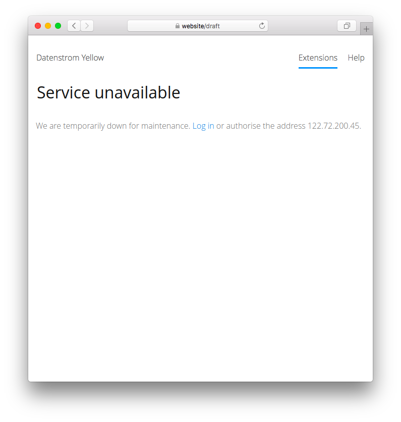

# Maintenance 1.0.0

Support for maintenance. Developed by Giovanni Salmeri.

## How to install an extension

[Download ZIP file](https://github.com/GiovanniSalmeri/yellow-maintenance/archive/refs/heads/main.zip) and copy it into your `system/extensions` folder. [Learn more about extensions](https://github.com/annaesvensson/yellow-update).

## How to enable the maintenance mode

To enable the maintenance mode for the whole site, set `Status: maintenance` in file `system/extensions/yellow-system.ini`.

To enable the maintenance mode for individual pages, set `Status: maintenance` in the [page settings](https://github.com/annaesvensson/yellow-core#settings-page) at the top of a page. 

You can edit the pages in the [web browser](https://github.com/annaesvensson/yellow-edit) and the file system.

## Examples

Content file with maintenance status:

    ---
    Title: Example page
    Status: maintenance
    ---
    This is an example page.

## Settings

The following settings can be configured in file `system/extensions/yellow-system.ini`:

`MaintenanceIps` = list of IPs authorised to view the pages in maintenance mode, e.g. `122.72.200.45, 122.72.200.82`  

## Acknowledgements

This extension was previously maintained by Jef Lippiatt. Thank you for the good work.

Do you have questions? [Get help](https://datenstrom.se/yellow/help/).
